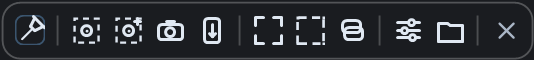
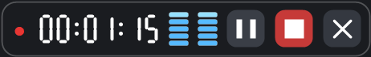
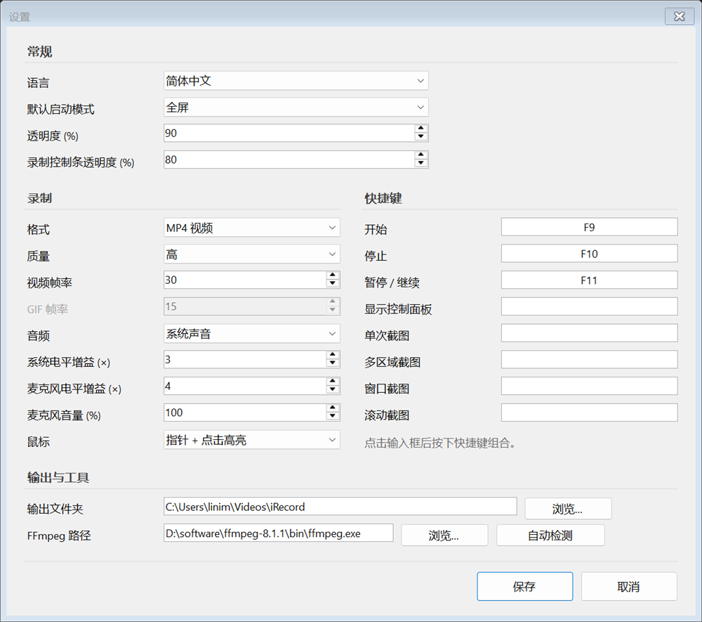
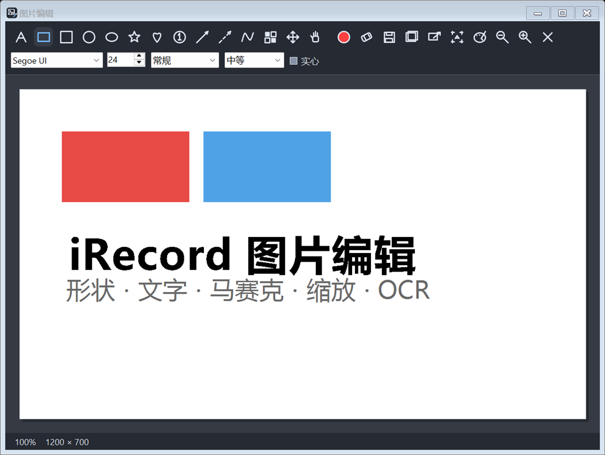

# iRecord 1.5.4

[English](README_en.md) | 简体中文

一个极简的 Windows 原生录屏工具。程序启动后常驻系统托盘，使用全局快捷键即可开始 / 暂停 / 停止录制，支持 **MP4 / MKV / MOV / WebM / GIF** 输出，并可把鼠标指针与点击效果录制进画面，使用 [**ScreenRecorderLib**](https://github.com/sskodje/ScreenRecorderLib) 进行高性能原生捕获与硬件编码，固定帧率输出；MKV / MOV / WebM / GIF 通过开源 [**FFmpeg**](https://ffmpeg.org/) 转换。

## 功能

- 托盘常驻，单实例运行，体积精简
- 无头命令行：`iRecord-cli.exe` 可在无界面情况下执行录制，便于脚本与大语言模型调用
- 三种录制范围：
  - 全屏（多显示器时显示红色选框，移动鼠标切换目标显示器，点击开始；单显示器直接开始）
  - 框选区域（拖动选择）
  - 指定窗口（鼠标悬停高亮，点击选择）
- 截图：区域截图（单次框选）、多区域截图（可连续框选多个区域并合并为一张大图）、窗口截图，以及自动滚动无痕拼接的窗口长截图（都会保存为 PNG 并自动复制到剪贴板）
- 控制面板按「置顶 / 截图 / 录制」分组，并用竖线分隔
- 控制面板支持置顶（图钉按钮），固定后不会被其他窗口遮挡
- 输出格式：`MP4`（ScreenRecorderLib 原生 H.264，固定帧率）、`MKV`（H.264）、`MOV`（H.264）、`WebM`（VP9 + Opus）或 `GIF`
- 录制引擎：ScreenRecorderLib 原生捕获与硬件编码，避免手动采样导致的实际帧率波动；全屏、区域和窗口均使用同一引擎
- 鼠标录制：不显示 / 显示鼠标指针 / 显示指针并高亮左右键与中键点击
- 音频录制：无音频 / 系统声音 / 麦克风 / 系统声音 + 麦克风
- 全局快捷键：开始、停止、暂停/恢复（默认 `F9` / `F10` / `F11`）；显示控制面板与单次/多区域/窗口/滚动截图快捷键可在设置中配置
- 桌面录制控制条：显示时长，提供暂停、停止、隐藏按钮；隐藏后可从托盘菜单重新显示；红色录制指示灯亮 1 秒、暗 1 秒，暂停时停止闪烁；鼠标离开后自动半透明，移入后恢复不透明；控制条不会出现在录制画面中
- 托盘图标：白色圆环始终显示；录制时中心红色以 1 秒显示、1 秒消失的节奏闪烁；停止后中心红色消失
- 录制边框：托盘录制和无头 CLI 录制时都会用红色边框标出实际录制区域，支持全屏 / 区域 / 窗口，窗口移动时自动跟随，且不会出现在录制画面中
- 音量提示：控制条以五格纵向电平显示系统声音与麦克风；麦克风音量在设置中调整（0–200%）
- 暂停/恢复会将暂停时段从视频与音频中剔除，音画保持同步
- 设置界面支持多语言切换：简体中文、繁體中文、English、日本語、한국어、Deutsch、Français、Español
- 可配置帧率、GIF 帧率、画质、系统/麦克风电平增益、麦克风音量、录制控制条透明度、鼠标录制方式、输出目录、FFmpeg 路径、快捷键与默认启动模式
- 版本 `1.5.4`

## 界面预览

### 主控制面板



截图、录屏、设置与打开输出目录等操作入口，固定按钮可让面板保持置顶。

### 录制控制条



显示录制时长、纵向五格系统/麦克风电平、暂停/停止/隐藏按钮；支持拖动、半透明和鼠标悬停恢复。

### 设置



可配置语言、录制格式与画质、快捷键、面板透明度、麦克风音量、输出目录和 FFmpeg 路径。

### 图片编辑



图片编辑支持形状/实心、文字、编号、马赛克、任意绘制、缩放平移、尺寸调整、文字识别和打开系统画图；通过移动工具可选择并拖动所有元素，按 Del 删除，编号双击重置且菜单图标显示下一个编号，撤销不设上限。

## 环境要求

- Windows 10 2004 及以上（推荐 Windows 11），仅支持 x64
- [.NET 10 Desktop Runtime](https://dotnet.microsoft.com/download/dotnet/10.0)（框架依赖发布方式）
- [Visual C++ 2015–2022 Redistributable (x64)](https://aka.ms/vs/17/release/vc_redist.x64.exe)（ScreenRecorderLib 依赖）
- MP4 输出无需 FFmpeg；MKV / MOV / WebM / GIF 需要 FFmpeg 可执行文件（`ffmpeg.exe`，官方地址：<https://ffmpeg.org/>）

## FFmpeg 配置

程序按以下顺序查找 FFmpeg：

1. 设置中手动指定的 `ffmpeg.exe`
2. 程序所在目录下的 `ffmpeg.exe`
3. `D:\software\ffmpeg-8.1.1\bin\ffmpeg.exe`
4. 系统 `PATH` 中的 `ffmpeg.exe`

使用 MP4 输出时无需 FFmpeg。首次启动若未找到 FFmpeg 且当前格式需要转换，会在托盘提示，可在「设置 → FFmpeg 路径」中指定或点击「自动检测」。

## 使用

1. 双击 `iRecord.exe`，会显示前台控制面板：最左侧为置顶按钮，随后是截图（区域 / 多区域 / 窗口 / 滚动长截图）、录制（全屏 / 区域 / 窗口），以及设置与打开输出目录。区域截图快速框选单个区域；多区域截图支持连续框选多个区域，按 Enter 后纵向合并为一张大图。程序同时常驻系统托盘（右下角）；关闭面板会隐藏到托盘，双击托盘图标可重新打开。截图与录像文件都会保存到设置的输出目录。
2. 右键托盘图标，选择：
   - 开始录制（全屏 / 区域 / 窗口）
   - 截图（区域 / 窗口 / 滚动长截图）
   - 暂停 / 继续
   - 停止
   - 设置
   - 打开输出文件夹
3. 也可以使用全局快捷键：
   - `F9` 开始录制（使用设置中的默认启动模式）
   - `F10` 停止录制
   - `F11` 暂停 / 恢复
4. 录制时桌面底部中央会出现控制条，可直接点击「暂停」「停止」；录制区域四周会显示红色边框。开启声音录制后，控制条显示系统 / 麦克风音量电平；麦克风音量在设置中调整。
5. 停止后自动编码，完成后托盘会提示文件保存位置。默认输出目录为 `视频\iRecord`。

## 构建

需要 .NET 10 SDK。

```powershell
dotnet restore
dotnet build -c Release
```

## 发布可执行程序

已提供脚本 `tools\build.ps1`，采用 **框架依赖 + 单文件 + 外置 ScreenRecorderLib.dll** 方式发布：

```powershell
powershell -ExecutionPolicy Bypass -File .\tools\build.ps1
```

输出目录：`publish\`，包含 `iRecord.exe`（托盘程序）、`iRecord-cli.exe`（无头命令行）和 `ScreenRecorderLib.dll`。请保持 `ScreenRecorderLib.dll` 与 exe 同目录；目标机器需安装 .NET 10 Desktop Runtime 与 Visual C++ 2015–2022 Redistributable (x64)。

如需一键完成发布并打包 zip（自动附带 README 与 `skills\`）：

```powershell
powershell -ExecutionPolicy Bypass -File .\tools\package.ps1
```

生成 `publish\iRecord-v<版本>-win-x64.zip`。Windows 下也可以直接双击 `tools\package.cmd`。可用 `-Runtime`、`-Configuration`、`-Output` 覆盖默认参数，或用 `-SkipBuild` 跳过编译、只重新打包。

## 无头命令行（自动化 / 大语言模型）

`iRecord-cli.exe` 是控制台程序，适合脚本与 LLM 工具调用：它会阻塞到编码完成并返回退出码。`iRecord.exe` 也接受相同参数，但它属于 GUI 子系统，部分 Shell 不会等待其结束。

运行 `iRecord-cli.exe help` 可查看完整能力说明（含返回的 JSON 结构与给 LLM 的使用建议）。常用命令：

```powershell
# 列出显示器 / 可录制窗口（输出 JSON）
iRecord-cli.exe list-screens
iRecord-cli.exe list-windows

# 录制屏幕区域 8 秒，输出 MP4 并返回 JSON 结果
iRecord-cli.exe record --mode region --region 0,0,1280,720 --duration 8 `
    --format mp4 --audio none --mouse clicks --output "C:\out" --json

# 录制指定窗口 10 秒，输出 WebM
iRecord-cli.exe record --mode window --window notepad --duration 10 --format webm --json
```

- `--json` 时 stdout 只输出一个 JSON 对象，进度与错误写入 stderr。
- `--result-file <path>` 可把相同结果同时写入文件，适合无法捕获 stdout 的环境。
- 退出码：`0` 成功，`1` 录制或编码失败，`2` 参数错误。
- 无头录制期间会在桌面上显示红色录制边框（全屏 / 区域 / 窗口）；不显示控制条和音量格。
- 无头模式仍需当前已登录且未锁屏的交互式桌面，不能录制锁屏或其他会话。

## 项目结构

更详细的目录、源文件职责和 AI 增量开发指南见 [docs/PROJECT_STRUCTURE.md](docs/PROJECT_STRUCTURE.md)。

```
Program.cs                     入口（托盘模式 / CLI 模式）
App/                           托盘、设置、本地化、快捷键、配置持久化
Capture/                       屏幕捕获、区域/窗口选择、音频录制、鼠标叠加、FFmpeg 编码
Cli/                           无头命令行：命令解析、录制流程、帮助文本
UI/                            设置窗口、录制控制条、快捷键输入框
Assets/app.ico                 应用图标
tools/build.ps1                发布脚本
tools/package.ps1              一键发布并打包 zip（package.cmd 为双击入口）
tools/make-icon.ps1            重新生成图标
tools/iRecord.Cli/             控制台启动器项目（生成 iRecord-cli.exe）
```

## 实现说明

- 屏幕捕获：ScreenRecorderLib（Windows Graphics Capture / Desktop Duplication），支持全屏、区域与窗口；固定帧率编码
- 音频捕获：ScreenRecorderLib 内置 Windows WASAPI 系统回环与麦克风采集，混音后写入 MP4
- 视频编码：ScreenRecorderLib 通过 Media Foundation 实时编码 H.264（优先硬件编码）；MP4 直接输出，MKV / MOV 无损封装，WebM / GIF 由 FFmpeg 转码
- 鼠标录制：ScreenRecorderLib 原生捕获光标，并检测鼠标点击绘制高亮效果
- 录制边框：置顶、点击穿透的边框窗口，大小随实际捕获区域更新，并通过 `WDA_EXCLUDEFROMCAPTURE` 排除出成片
- 音量提示与增益：基于 ScreenRecorderLib 音频包数据计算峰值电平；麦克风音量通过音频源音量应用
- 暂停/恢复：调用 ScreenRecorderLib 原生暂停/恢复，暂停时段不计入成片，音画保持同步
- 控制条通过 `SetWindowDisplayAffinity(WDA_EXCLUDEFROMCAPTURE)` 从录制画面中排除

## 已知限制

- 无头 CLI 模式会显示录制红框，但不显示控制条和音量格
- 使用 ScreenRecorderLib 捕获；独占全屏 / 硬件覆盖层（部分游戏）可能显示为黑屏
- WebM 需要将视频重新编码为 VP9，生成速度明显慢于其他格式
- 若所选音频源在录制期间完全无声（尤其是系统声音），成片可能不包含音频轨
- 麦克风与系统声音会统一混音为 48 kHz 立体声 AAC

## 版本

1.5.4
